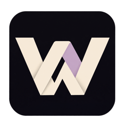

<div align="center">



# WEFTORY

**A fashion video studio for macOS.**

Turn one SKU and one virtual model into a vertical product video.<br />
Direct the shots, review the cut, and deliver the approved video.

**English** · [简体中文](README_zh.md)

</div>

## From product to final cut

1. **Set up your product and model.** Add product photos and selling points, then select a virtual model.
2. **Direct the storyboard.** Edit the shot directions and subtitles, then approve the storyboard to start generation. The commuter outfit template uses six shots and runs for 21 seconds.
3. **Review and deliver.** Preview the assembled cut and regenerate individual shots as needed. Approve the final cut, then export it as an MP4 or have it delivered through a configured Feishu bot.

Live projects have a per-video budget cap. The local production queue can resume jobs when you reopen the studio.

## Run the studio

On an Apple Silicon Mac, use Node.js 24.15 or later in the 24.x series and npm 11.17 or later in the 11.x series. For development, put FFmpeg and ffprobe in `/opt/homebrew/bin` or `/usr/local/bin`. FFmpeg needs libx264 and the subtitles filter.

```sh
npm ci
npm run electron:dev:openclaw
```

For subsequent launches, run `npm run electron:dev`.

In **Production**, choose **Run a demo** to try storyboard approval, shot rework, and MP4 export without configuring generation models. For live production, configure a text model and the Ark Seedream and Seedance endpoints in **Setup**. See the [setup and macOS packaging guide](docs/weftory-mvp.md) for model access, budgets, and Feishu delivery.

## License

[MIT](LICENSE). WEFTORY builds on LobsterAI and uses OpenClaw as its agent runtime.
