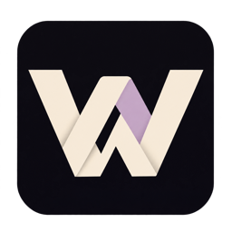

<div align="center">



# WEFTORY

**macOS 服装视频工作室**

用一款商品和一位虚拟模特，制作竖屏商品视频。<br />
编辑分镜、审片、交付，每一步都在工作室完成。

[English](README.md) · **简体中文**

</div>

## 从商品到成片

1. **准备商品与模特。** 添加商品图片和卖点，选择一位虚拟模特。
2. **编辑分镜脚本。** 调整镜头描述和字幕，审批后开始生成。通勤穿搭模板包含 6 个镜头，成片时长 21 秒。
3. **审片与交付。** 预览成片，按需单独重做镜头。审批后可导出 MP4，也可通过已配置的飞书机器人交付。

正式制作可为每条视频设置预算上限。重新打开工作室后，本地制作队列可以继续处理未完成的任务。

## 启动工作室

在搭载 Apple 芯片的 Mac 上，使用 Node.js 24.15 及以上的 24.x 版本和 npm 11.17 及以上的 11.x 版本。开发时，将 FFmpeg 和 ffprobe 放在 `/opt/homebrew/bin` 或 `/usr/local/bin`。FFmpeg 需要支持 libx264 和 subtitles 滤镜。

```sh
npm ci
npm run electron:dev:openclaw
```

后续启动可运行 `npm run electron:dev`。

在 **视频制作** 中选择 **运行演示**，无需配置生成模型即可体验分镜审批、单镜头重做和 MP4 导出。正式制作前，在 **设置** 中配置文本模型以及火山方舟的 Seedream 和 Seedance 端点。模型接入、预算和飞书交付的细节见[配置与 macOS 打包指南](docs/weftory-mvp.md)。

## 许可证

[MIT](LICENSE)。WEFTORY 基于 LobsterAI 构建，使用 OpenClaw 作为 Agent 运行时。
